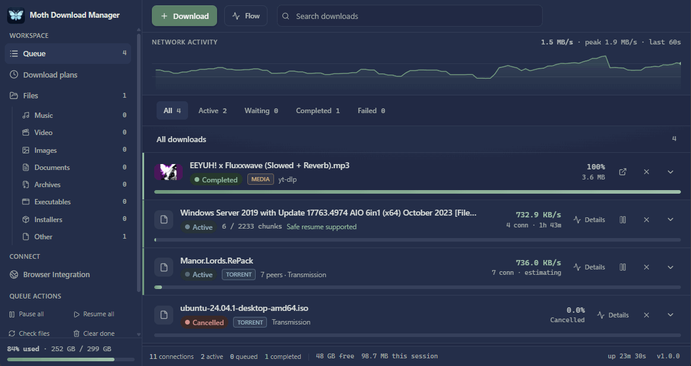
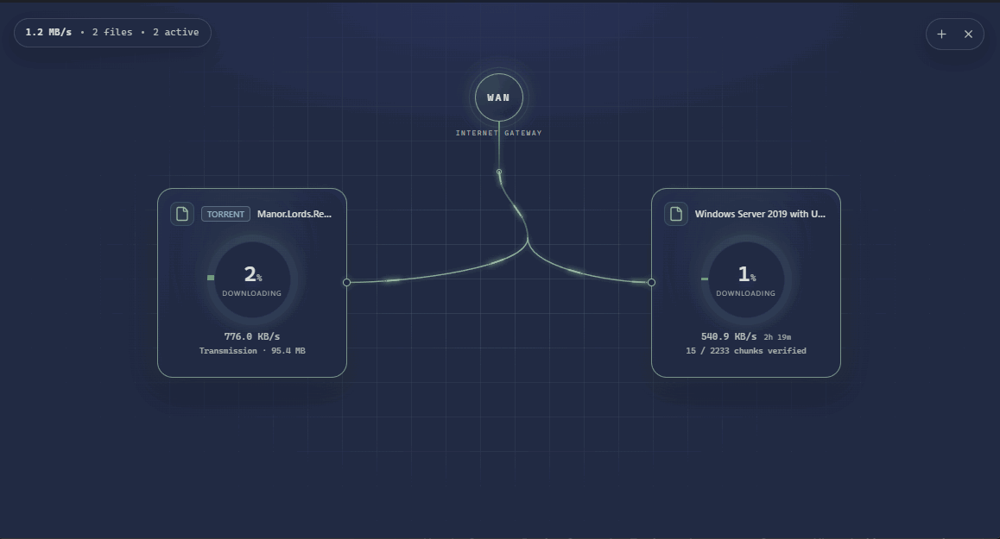

<p align="center">
  
</p>

<h1 align="center">Moth Download Manager</h1>

<p align="center"><strong>A desktop download manager that will not hand you a corrupt file.</strong></p>

<p align="center">
  Multi-threaded resumable HTTP transfers, a dedicated yt-dlp/FFmpeg media pipeline,
  and BitTorrent — with a verified chunk map that survives a hard power cut.
</p>

<p align="center">
  <a href="https://www.electronjs.org/"></a>
  <a href="https://www.typescriptlang.org/"></a>
  <a href="LICENSE"></a>
  <a href="https://github.com/realLLUKS/Moth-DL/actions/workflows/verify.yml"></a>
  
</p>

<p align="center">
  <a href="mothwebsite.html"><strong>🌐 Product website</strong></a>
  &nbsp;·&nbsp;
  <a href="mothwebsite.html">View the landing page</a>
</p>

---

<p align="center">
  
</p>

---

## The guarantee

Most "resumable" downloaders track a single byte counter. That is not enough. If the
process dies mid-write, the counter can be ahead of what actually reached the disk, and
the resumed file is silently corrupt.

Moth tracks a **bitmap of completed byte ranges** instead, and enforces one ordering
rule:

> A chunk is only marked `complete` in the database *after* its bytes have been
> `fsync`'d to disk.

The database runs in WAL mode with `synchronous=FULL`, so a committed `complete` row
is a durable promise that the bytes really are on disk. On restart, recovery re-digests
every completed chunk anyway, and anything that does not match is thrown away and
re-downloaded.

**If a source cannot be verified, Moth restarts it rather than risk a corrupt file.**
Progress is never worth a file you cannot trust.

---

## Features

### Transfers

- **Multi-threaded resumable HTTP** — parallel `Range` requests with a configurable
  connection count, chunk planning sized to the file, and a hard cap on chunk count.
- **Smooth speed limiting** — a GCRA rate limiter gives the exact long-run rate with no
  bursts, and it stays enforceable at very low rates where a naive token bucket stalls.
- **Refreshed links keep progress** — a dead URL can be replaced, and partial data is
  kept only when file size and a strong `ETag` still match the original.
- **Queue you can shape** — priorities, drag reordering, a review queue that looks
  links up in the background, scheduled starts, and one-off run plans for timed groups.
- **Focus mode** — promote specific downloads to the front and temporarily cap
  everything else without pausing a single transfer.
- **BitTorrent** — v1/v2 magnets and `.torrent` sources through a bundled Transmission
  daemon, with per-file selection and per-torrent caps. Windows x64 packages.
- **Media pipeline** — a dedicated yt-dlp/FFmpeg path that selects streams, stages
  output, and verifies the decode before declaring a video finished.

### Integrity

- **Checksums** — MD5, SHA-1, SHA-256 and SHA-512 verification, plus a fast CRC-32 for
  chunk-level corruption detection.
- **Per-chunk digests** — recorded when a chunk completes and re-verified on the next
  startup, so silent disk rot is caught rather than trusted.
- **Source identity checks** — `ETag` / `Last-Modified` are sent back as `If-Range`.
  If the remote file changed, progress is discarded instead of stitching bytes from
  two different versions of a file.
- **Honest about weak validators** — an `ETag` is a server validator, not a
  cryptographic checksum, and the UI says so. A digest computed without an expected
  checksum is a fingerprint, not proof.
- **Staged promotion** — in-flight files are written as `.mothpart` and only renamed to
  their final name after the download completes *and* verifies.

### Files

- **Auto-categorisation** by extension, with content-type fallback for URLs that carry
  none.
- **Path-traversal-safe destinations** — every path derived from a remote filename is
  contained within your download root, so a hostile `Content-Disposition` cannot escape.
- **Collision-free naming** — `file.zip` becomes `file (1).zip`.
- **Media metadata** — reads and writes ID3v2.3 and MP4 tags, plus artwork, across
  MP3, FLAC, Ogg and MP4.

### Interface

- **Live throughput graph** with your speed-limit ceiling drawn in, plus a per-chunk
  heat map showing exactly what is already on disk.
- **Flow mode** — a full-screen top-down view of every transfer hung off a WAN gateway,
  with live speed, verified-chunk counts, and per-transfer controls.
- **Per-download details** — speed trace, active connections, progress, and the durable
  completed-range map.
- **Four themes** — Graphite, Moth Amber, Fieldnotes and your system appearance.
- **System tray** background running, plus desktop notifications on completion and
  failure.

---

## Screenshots

<p align="center">
  
</p>

<p align="center"><strong>Flow mode</strong> — every transfer hung off a WAN gateway, with live speed, verified-chunk counts, and per-transfer controls. Torrent transfers carry their own badge and engine line, because Transmission tracks pieces rather than HTTP chunks.</p>

---

## Getting started

### Requirements

| | |
|---|---|
| **Node** | 22.5+ (developed and verified on 24.x) |
| **OS** | Windows 10/11, macOS 11+, or Linux with a desktop environment |
| **Build toolchain** | *none* |

**No native addons.** Persistence rides on Node's built-in `node:sqlite`, so there is
no `node-gyp`, no Visual Studio build tools, and no prebuilt-binary ABI drift. A plain
`npm install` works on a clean machine.

Feature support is **not** identical across platforms. Direct HTTP, the yt-dlp/FFmpeg
media pipeline, and the browser extension work everywhere. **BitTorrent is Windows
x64 only**, because that is the only platform whose package bundles the Transmission
daemon.

### Run from source

```bash
npm install     # also runs an environment self-check
npm run dev     # Vite dev server + Electron with HMR
```

### Build a desktop package

```bash
npm run package   # unpacked  -> release/autopair-build/win-unpacked/
npm run dist      # NSIS installer
```

Both commands download and hash-verify the bundled Transmission runtime first, so
nothing large or vendored is committed to this repository.

### Verify

```bash
npm run verify    # typecheck + unit tests + extension tests + smoke + ingest
```

---

## Documentation

| Document | What it covers |
|---|---|
| [Product website](mothwebsite.html) | Marketing/landing page for the app (single self-contained HTML file) |
| [Architecture](docs/ARCHITECTURE.md) | Process layout, module boundaries, design decisions |
| [Data model & storage](docs/DATA-MODEL.md) | SQLite schema, chunk map, on-disk layout, crash recovery |
| [Extending Moth](docs/EXTENDING.md) | Where to add features, and the invariants that must hold |
| [Troubleshooting](docs/TROUBLESHOOTING.md) | Common problems and how to read the logs |
| [App recreation spec](docs/APP-RECREATION-SPEC.md) | Full source-grounded product and behaviour specification |
| [Browser extension](browser-extension/README.md) | Pairing, permissions, threat model |
| [Standalone CLI](cli/README.md) | The dependency-free direct-download core and its fault lab |
| [Future directions](docs/FUTURE-DIRECTIONS.md) | Ideas, explicitly not promises |

---

## Browser integration

A desktop app **cannot** silently intercept Chrome's downloads — there is no OS hook
for it. Instead, Moth ships an extension that pairs with the running app over a
**loopback-only HTTP endpoint**, guarded by a 32-byte CSPRNG token compared in constant
time.

The extension can send a link or media page directly, hand off the browser's own
downloads, or simply watch the browser downloads folder. The endpoint binds `127.0.0.1`
only — never `0.0.0.0`, because a download manager that accepts commands from the LAN
is a remote code execution vector. See the [extension README](browser-extension/README.md)
for the pairing flow and full threat model.

---

## BitTorrent

BitTorrent v1/v2 magnets and `.torrent` sources run through Transmission — a separate
engine from the HTTP range downloader. Moth creates a private daemon configuration and
binds its authenticated RPC service to loopback. Transfers are piece-verified by
Transmission, pause and resume through the normal queue controls, and stop on
completion.

The runtime is downloaded and hash-verified at package time rather than vendored.
Transmission is bundled as a separate process under its GPL license, with the
corresponding source archive included in the Windows package — see the
[bundled-runtime notice](resources/transmission/NOTICE.md).

---

## Limitations

Stated plainly, because a download manager that hides these is worse than one that
does not.

- **Torrent support is platform-scoped** to Windows x64 packages. Tracker/peer
  administration, RSS/search, configurable seeding, and quotas are not provided.
- **No HLS / `.m3u8` support.** Segmented playback needs a playlist parser, a segment
  fetcher, AES-128 decryption and a container remux — a project in its own right.
- **Content-agnostic transport.** Streams are passed through as bytes; Moth does not inspect, filter, or refuse a payload by what it contains — and never decrypts one.
- **No browser cookie or session import.** Sites behind a login need the extension,
  which forwards `Cookie` and `Referer` for that request.
- **A server that refuses `Range` cannot be resumed.** It downloads as a single stream
  and restarts from zero; the UI labels it `no resume` up front.
- **No resume when the remote file changed** — progress is discarded rather than risking
  mixed content.
- **The ingest endpoint is IPv4 loopback only.**
- **Recovery re-verification is capped at 512 MB per download**; larger downloads are
  verified by sampling on startup.
- **Multi-threaded transfers cap at 32 connections per download.**
- **Tags are written for ID3v2.3 and MP4 only.** Reading is broader.
- **One download directory** — no mirroring or remote backup.

---

## Contributing

I maintain this, I review and merge pull requests — and **forks are genuinely
welcome**. The architecture is layered on purpose so a fork can diverge in one
area without rewriting the rest, and a few ideas are simply too large for a
patch. If you fork, say what you are building.

There is no CLA.

Start with [CONTRIBUTING.md](CONTRIBUTING.md) — project layout, conventions, the
validation gate, and the transfer-integrity invariants that changes must not
regress. Looking for something to pick up? [Future directions](docs/FUTURE-DIRECTIONS.md)
lists open ideas.

## Security

Report vulnerabilities privately via
[GitHub security advisories](https://github.com/realLLUKS/Moth-DL/security/advisories/new)
rather than opening a public issue. See [SECURITY.md](SECURITY.md) for what counts
and what is deliberately out of scope.

Moth binds its ingest endpoint to `127.0.0.1` only, validates every renderer→engine
payload with a zod schema, and contains all remote-derived paths inside your
download root. Treat any bypass of those as a bug.

## License

MIT — see [LICENSE](LICENSE). The Windows package additionally bundles the
GPL-licensed Transmission daemon as a separate process with its source archive;
see the [bundled-runtime notice](resources/transmission/NOTICE.md).